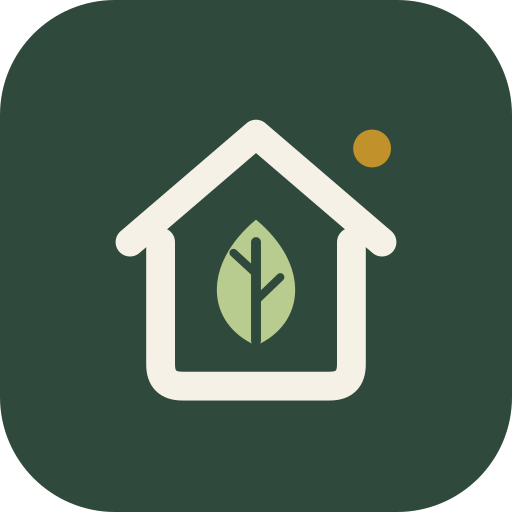
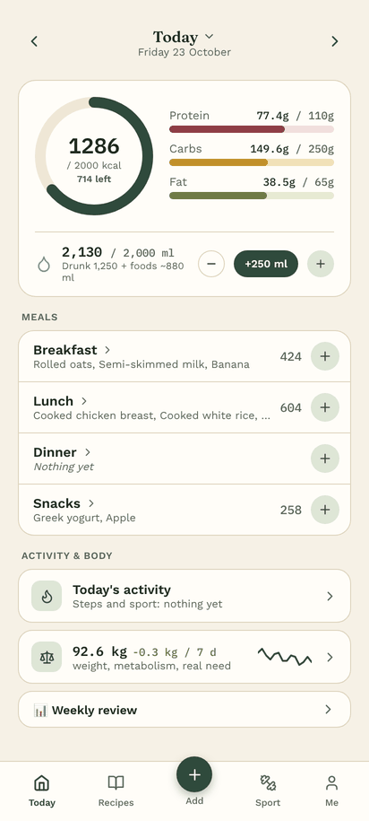
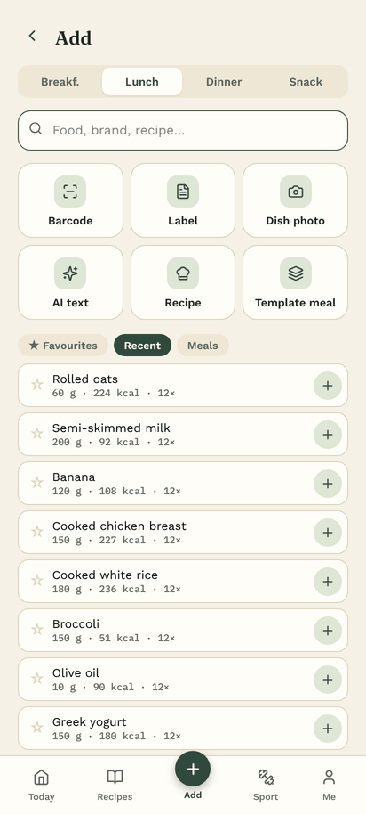
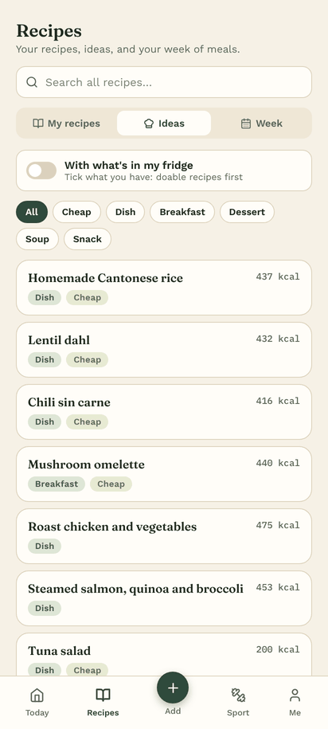
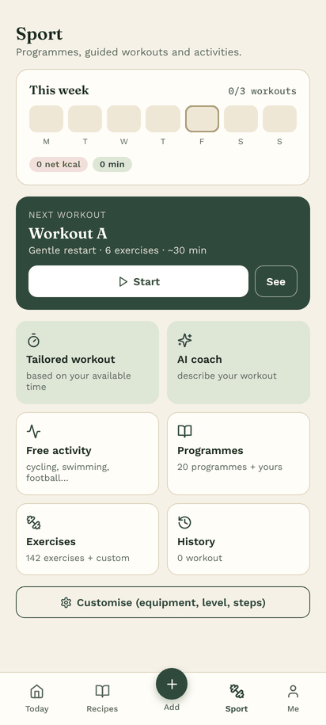
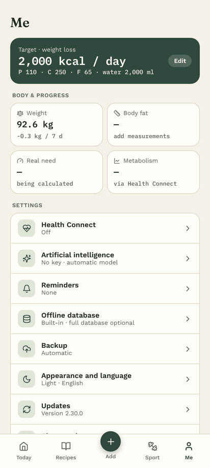
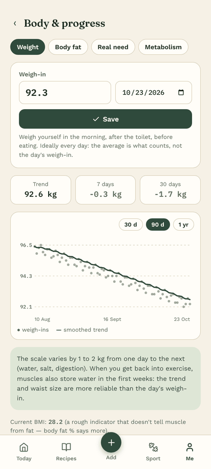
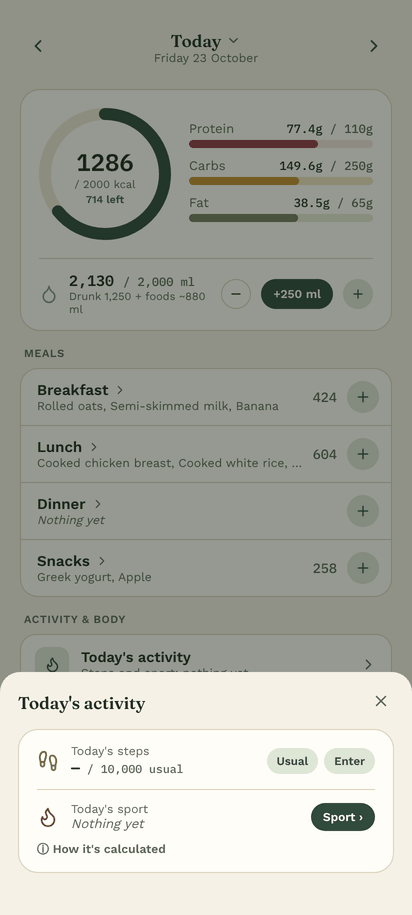
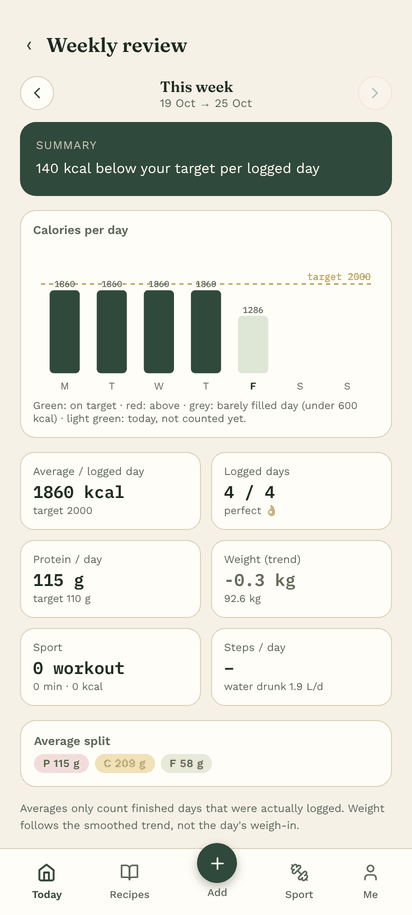
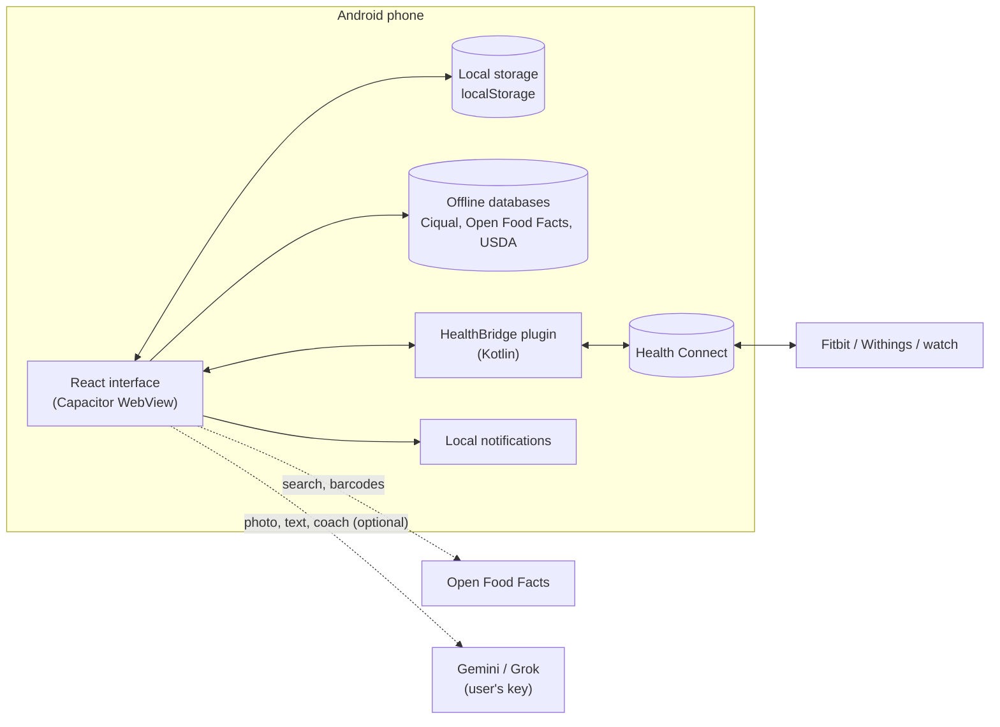

<p align="center">
  🇫🇷 <a href="README.md">Français</a> · 🇬🇧 <b>English</b>
</p>

<p align="center">
  
</p>

<h1 align="center">NutriMaison</h1>

<p align="center">
  Nutrition, weight and workout tracking for Android — in English or French, free, no account and no server.
</p>

<p align="center">
  <a href="LICENSE"></a>
  
  
</p>

> 📦 **Don't want to build it?** The ready-to-install APK is in the **[Releases](../../releases/latest)**: download `nutrimaison-vX.Y.Z.apk` and install it directly on your phone ([see how](#install-the-ready-made-apk)).

## Preview

<table>
  <tr>
    <td align="center"><br><sub>Home</sub></td>
    <td align="center"><br><sub>Add</sub></td>
    <td align="center"><br><sub>Recipes</sub></td>
    <td align="center"><br><sub>Sport</sub></td>
  </tr>
  <tr>
    <td align="center"><br><sub>Me</sub></td>
    <td align="center"><br><sub>Body & progress</sub></td>
    <td align="center"><br><sub>Today's activity</sub></td>
    <td align="center"><br><sub>Weekly review</sub></td>
  </tr>
</table>

---

## Contents

- [Preview](#preview)
- [Why NutriMaison](#why-nutrimaison)
- [Features](#features)
- [How it works](#how-it-works)
- [Install the ready-made APK](#install-the-ready-made-apk)
- [Build from source](#build-from-source)
- [In-app settings](#in-app-settings)
- [Project structure](#project-structure)
- [Offline food databases](#offline-food-databases)
- [Publish a release (APK)](#publish-a-release-apk)
- [Development](#development)
- [Troubleshooting](#troubleshooting)
- [Privacy](#privacy)
- [Data sources and licences](#data-sources-and-licences)
- [Licence and contributions](#licence-and-contributions)

---

## Why NutriMaison

A free alternative to paid tracking apps: every feature is available without a subscription, and **all data stays on the phone**.

The core idea: formulas for calculating needs (Mifflin-St Jeor, activity level…) are often off by several hundred calories. NutriMaison compares **what you log** with **how your weight actually changes** to calculate your **real need**, and adjusts your target accordingly.

## Features

### Nutrition
- **Diary by meal** (breakfast, lunch, dinner, snacks): one block per meal with its totals, collapsible.
- **Weekly plan** (Recipes → Week): recipes and template meals placed on days, planned kcal per day, "Log" on the day (the planned dish also shows in the meal on the home screen), weekly shopping list minus what's already in the fridge, copy of the previous week.
- **Today's expenditure by app**: calories from each app present in Health Connect (Withings, Fit, Fitbit…), average of the chosen sources (tap an app to include or exclude it; Fitbit excluded by default), and comparison with the real need calculated from your weight.
- **Basal metabolic rate over time** (Body & progress → Metabolism): curve per app (Withings, Fitbit…) from 7 days to 1 year, value on a given day, change in lean mass and body fat read from the scale via Health Connect.
- **Dark mode**: Me → Appearance and language (same as the phone, light or dark).
- **English or French**: Me → Appearance and language (same as the phone, Français, English). Dates, numbers and AI answers follow the chosen language; your data doesn't change.
- **Calendar**: tap the date at the top of the home screen to jump to any day; coloured dot according to the calorie target, ⚖ on weigh-in days.
- **Built-in Ciqual database**: 3,341 official generic foods (Anses, French food composition table), available offline, accent-insensitive word-by-word search.
- **Branded products** via Open Food Facts and a **barcode scanner** (native Android detector, ZXing as fallback, torch, photo, manual entry of the digits), also offline (see [Offline food databases](#offline-food-databases)). Unknown product: added with a single form (label read by AI, optional), found at the next scan.
- **Meal photo** analysed by AI (Gemini or Grok, optional) or local detection (TensorFlow.js).
- **Scan a label** (Add → Label): photo of the nutrition table, frame to adjust on the table, read by AI (even in a foreign language, kJ and sodium converted), editable values per 100 g and per serving, product saved in your products and added to the meal.
- **Import a recipe** (Recipes → My recipes → Import): pasted Instagram post description, **link** (public Instagram post, TikTok, blog: the page's structured recipe or the post caption is read) or **video** (Gemini reads the burned-in subtitles and listens to the voice). The AI converts everything to grams, links ingredients to the Ciqual table when it's sure, and opens "Check the recipe" (creator, link, ingredients, steps) before saving.
- **AI text**: "2 tortillas, 150 g chicken, some cheddar" → foods, quantities and estimated values, editable before adding. Recipe mode with servings.
- **Favourites, recent items, template meals** and **"Same as the day before"** to log in seconds; copy a whole meal or a few foods from/to another day.
- **Values editable on the fly** when your product differs from the database one (option: remember it).
- **Edit** each logged food: quantity, meal, day; "I ate ½" (or ¼, ⅔…) of a food or a whole meal.
- **Recipes**, in 3 tabs with a shared search: **My recipes** (most logged first, filters), **Ideas** (built-in recipes by category, "With what's in my fridge" switch: doable recipes, what's missing, AI ideas, TheMealDB) and **Week** (plan + shopping list).
- **My fridge**: what you have at hand → doable recipes, what's missing, dish ideas by AI, shareable **shopping list**.
- **Hydration**: choice of amount (glass, can, bottle… or free), quick button that remembers the last amount, water drunk + water contained in food (Ciqual values).

### Body and progress
- **Weigh-ins** with a **smoothed trend** curve (the day's weigh-in varies by 1 to 2 kg, the trend doesn't).
- **Body fat**: **US Navy** and **US Army 2023** methods, lean mass, Katch-McArdle metabolism.
- **Real need**: calculated over 4 weeks from logged meals and the change in weight, with a suggested new target.
- **Weekly review**: calories day by day, averages, protein, weight trend, sport, projection.

### Sport
- 142 exercises, 20 programmes (home, dumbbells, resistance bands, kettlebell, gym, boxing, mobility, running, cycling…).
- **Guided workouts**: timer, rest times, beeps and vibrations, screen kept on.
- **Level-based progression** (e.g. push-ups: wall → worktop → chair → knees → classic…) with a suggested level-up.
- **Tailored workout** offline based on available time, goal and equipment.
- **AI coach** (Gemini or Grok): "30 min of boxing without jumps" → complete workout.
- Boxing round timer, 54 free activities, history and records.
- **Net** calories (beyond rest), calculated from your weight. Daily steps included in your need without double counting.

### Integrations
- **Health Connect** (Fitbit, Withings, Pixel Watch…): sends meals, hydration, workouts, weigh-ins and body fat; reads steps, weight, measured calories and workouts. **No duplicates** (see below).
- **Reminders**: in the evening if nothing is logged, in the morning if you haven't weighed yourself.
- **Backup / restore** of all data (text export, automatic copy in Documents).

## How it works

### Architecture



- The interface is a **React** app (Vite) packaged as an APK by **Capacitor 6**.
- All data is in the app's **local storage** (`localStorage`). There is **no NutriMaison server**.
- The only network calls are Open Food Facts (branded products), TheMealDB (online recipes), GitHub (update check, optional full database) and the AI provider (only if a key is entered).
- Health Connect goes through a **small home-made Kotlin plugin** (`native/android/HealthBridgePlugin.kt`) that uses the official `androidx.health.connect:connect-client` library.

### Calculating needs

| Step | Method |
|---|---|
| Basal metabolic rate | Mifflin-St Jeor, or Katch-McArdle if body fat is known |
| "Detailed" mode | basal × 1.2 + steps beyond 3,500/day + sport planned in the programme |
| "Simple" mode | basal × activity level |
| Weight-loss target | maintenance − 20% (max 500 kcal), with a safety floor |
| Protein | 2.2 g/kg of lean mass, or 1.8 g/kg of a capped reference weight |
| Sport calories | net: (MET − 1) × weight × duration |
| Steps | 0.5 kcal/kg/km, stride length ≈ 0.415 × height |

### Real need (adaptive)

```
real need = average logged intake − (weight slope in kg/day × 7,700)
```

- 28-day window, at least **6 weigh-ins** over **14 days or more**, and meals logged at least **6 days out of 10**.
- The slope is calculated by least squares over the weigh-ins, not from two isolated points.
- This calculation automatically corrects small regular logging omissions (oil, sauces, drinks).

### Health Connect without duplicates

Each piece of data has **a single source**:

| Data | Source | NutriMaison |
|---|---|---|
| Meals, macros | NutriMaison | **writes** |
| Hydration (water drunk) | NutriMaison | **writes** |
| Workouts done in the app | NutriMaison | **writes** (type, duration) |
| Calories of those workouts | watch | not written by default |
| Weigh-ins typed by hand | NutriMaison | **writes** |
| Scale weigh-ins | Withings | **reads** (never sent back) |
| Steps | watch / phone | **reads** (total de-duplicated by Health Connect) |
| Measured calories, external workouts | watch | **reads** (display) |

Mechanisms:
- each record sent has a **stable `clientRecordId`** (`nm_food_<id>`, `nm_weight_<date>`…): an edit **replaces** the old one instead of creating a new one;
- a deletion or move in the app is **mirrored** in Health Connect;
- data read **excludes** what NutriMaison wrote;
- a manual entry (steps, weight) **takes priority** over the import for that day.

Sync: when the app opens, when you come back to it (after a minute), and 4 seconds after each change. Android doesn't allow background reading without a special permission.

## Install the ready-made APK

The simplest way, with nothing to install on a computer.

1. On the phone, open the **[Releases](../../releases/latest)** page and download the `nutrimaison-vX.Y.Z.apk` file of the latest version.
2. Open the downloaded file. Android asks you to allow installation from your browser or file manager: accept for this source.
3. **Play Protect** shows a warning, because the app doesn't come from the Play Store: tap **More details → Install anyway**. This is normal for any app installed outside the Play Store.
4. Open NutriMaison, then go to **Me** to fill in your profile (and, if you want, your free Gemini key for the AI features).

**Requirements**: Android 8.0 or later. Health Connect needs Android 9 or later (built in from Android 14).

**Updating**: download the new version and install it over the old one, your data is kept. As a precaution, first do **Me → Backup → Back up now**.

> ⚠️ An update only installs over the existing app if it's signed with the **same key**. If you switch from the Releases APK to a version you built yourself (or the other way round), Android will refuse: export your data, uninstall, install the new version, then restore (**Me → Backup → Restore**).

## Build from source

### Requirements

- [Node.js](https://nodejs.org) 18 or later
- [Android Studio](https://developer.android.com/studio) with **Android SDK 36** (Tools → SDK Manager)
- **JDK 17** (Android Studio's one is fine)

### First installation

```bash
git clone <repository-url> nutrimaison
cd nutrimaison
setup.bat          # Windows
./setup.sh         # macOS / Linux
```

`setup` runs:
1. `npm install`
2. `npm run build` (web app in `dist/`)
3. `npx cap add android` (if the `android/` folder doesn't exist)
4. `node scripts/patch-android.mjs` (see below)
5. `npx cap sync`

Then:

```bash
npx cap open android
```

In Android Studio: let the Gradle sync finish (choose **JVM 17** if asked), then **Build → Generate App Bundles or APKs → Build APK(s)**.

The APK is in `android/app/build/outputs/apk/debug/app-debug.apk`.

> On Windows, keep the project in a folder whose path has no accents (e.g. `D:\nutrimaison`): Gradle refuses paths with non-ASCII characters.

### The `patch-android.mjs` script

The `android/` folder is **generated** (it isn't versioned). The script applies all the necessary changes and can be run again safely:

- copies the Health Connect Kotlin plugin and the privacy page required by Android;
- registers the plugin in `MainActivity`;
- moves to **Android Gradle Plugin 8.9.1**, **Gradle 8.11.1**, **Kotlin 2.1.21**, **compileSdk 36**, **minSdk 26** (required by Health Connect 1.1.0);
- adds the Health Connect library and Kotlin coroutines;
- completes the manifest: camera, notifications, Health Connect permissions, `<queries>`;
- installs the **logo** (adaptive and monochrome icons, splash screen, notification icon);
- carries the `package.json` **version** into the APK;
- checks that the `android/` folder matches the app identifier (`appId` in `capacitor.config.json`, currently `app.nutrimaison`).

### Updating the app without losing data

```bash
git pull
npm install
npm run build
node scripts/patch-android.mjs
npx cap sync
```

Rebuild **on the same PC** (same debug signing key) and install over the old version. To be safe: **Me → Backup → Back up now** first.

To install without the Play Protect warning, use ADB:

```bash
adb install -r android/app/build/outputs/apk/debug/app-debug.apk
```

## In-app settings

| Where | What |
|---|---|
| **Me → Goals → Calculate my needs** | Sex, age, height, weight, detailed mode (steps + sport) or simple, goal |
| **Me → Artificial intelligence** | Provider of your choice: **Gemini** (free key at [aistudio.google.com](https://aistudio.google.com)) or **Grok** (key at [console.x.ai](https://console.x.ai), pay-as-you-go). Video reading only exists with Gemini. "Test the key" button. Model: "Automatic (recommended)" or a specific model, list updated with "Refresh the model list". Switches to another model if one is overloaded or retired. |
| **Me → Reminders** | Evening reminder and weigh-in reminder |
| **Me → Health Connect** | Turn on, choose what is sent and read, "Allow access" |
| **Me → Offline database** | Built-in databases, download / update / delete the full database |
| **Me → Appearance and language** | Light / dark theme, language |
| **Me → Goals → Sport calories** | Eat back sport calories: no (recommended), half, all |
| **Sport → Customise** | Equipment, level per movement, sessions per week, no-jump mode, usual steps |
| **Body & progress → Body fat** | Measurements, Navy or Army method |

## Project structure

```
nutrimaison/
├── src/
│   ├── main.jsx               React entry point
│   ├── App.jsx                Global app state, navigation, saving data
│   ├── version.js             Version number (read from package.json)
│   ├── foodData.js            Foods, built-in recipes, search, calculations (water, macros, fridge)
│   ├── views/
│   │   ├── Dashboard.jsx      "Today" home: ring, water, activity, meals
│   │   ├── AddView.jsx        Add: search, favourites, scanner, photo, AI text
│   │   ├── Recipes.jsx        Recipes (My recipes, Ideas, Week), detail, creation
│   │   ├── Planning.jsx       Weekly plan
│   │   └── Profile.jsx        Me: goals, reminders, backup, updates, settings
│   ├── shared.jsx             Storage, dates, energy calculations, shared components
│   ├── ciqual.json            Compact Ciqual table (generated, see scripts/)
│   ├── ciqualDb.js            On-demand loading and Ciqual search
│   ├── scanner.js             Barcode scanner and camera
│   ├── gemini.js / grok.js    AI calls: model choice, retry, fallback
│   ├── AiMeal.jsx             "AI text" tab and food estimation
│   ├── LabelScan.jsx          Nutrition label scan
│   ├── RecipeImport.jsx       Recipe import (text, link, video)
│   ├── MealTools.jsx          Meal copy, template meals, unknown product at scan
│   ├── CatPicker.jsx          Recipe category picker
│   ├── Fridge.jsx             My fridge, AI dish ideas, shopping list
│   ├── Calendar.jsx           Month calendar (direct access to a day)
│   ├── planning.js            Plan: values of planned dishes, weekly shopping
│   ├── backup.js              Backup, restore, automatic copy in Documents
│   ├── updates.js             New version check (GitHub Releases)
│   ├── Weight.jsx             Weight, trend, body fat, real need
│   ├── Metabolism.jsx         Basal metabolic rate over time
│   ├── Bilan.jsx              Weekly review
│   ├── Sport.jsx              Sport tab: programmes, guided workout, history
│   ├── SportGen.jsx           Tailored workout and AI coach
│   ├── sportData.js           Exercises, programmes, activities (MET values)
│   ├── healthconnect.js       Health Connect sync (anti-duplicate logic)
│   ├── HealthConnectCard.jsx  Health Connect settings
│   ├── reminders.js           Reminders (local notifications)
│   ├── offlineDb.js           Offline databases: built-in, full (downloaded), USDA
│   ├── i18n.js                Interface language (French / English)
│   ├── i18n/en.json           English translations (French text → English text)
│   └── data/                  Built-in food databases (generated, see scripts/)
├── native/
│   ├── android/               Kotlin plugin + Android resources (icons, splash)
│   └── brand/                 Source logo (SVG)
├── scripts/
│   ├── patch-android.mjs      Prepares the generated Android project
│   ├── ciqual-to-json.py      Converts the Ciqual Excel file into src/ciqual.json
│   ├── ciqual-en.py           Official English Ciqual names (app in English)
│   ├── build-food-db.mjs      Builds the offline databases (Open Food Facts, USDA)
│   └── i18n-check.mjs         Interface texts still without an English translation
├── build-apk.sh               Signed APK on Linux without Android Studio
├── public/                    Favicon
├── setup.bat / setup.sh       One-command installation
├── capacitor.config.json
└── vite.config.js
```

### Stored data (localStorage)

| Key | Content |
|---|---|
| `day:YYYY-MM-DD` | Meals, water, steps and Health Connect data for the day |
| `goals`, `personalInfo` | Goals and profile (including the AI keys) |
| `weights`, `weightSources`, `measures` | Weigh-ins, origin of each weigh-in, measurements |
| `workouts`, `sportSettings` | Workouts done, settings and custom programmes |
| `customFoods`, `customRecipes`, `favorites`, `mealTemplates` | Custom foods, recipes, favourites and template meals |
| `pantry`, `fridgeExtras`, `shoppingList` | Fridge contents and shopping list |
| `mealPlan`, `theme`, `language` | Weekly plan, appearance (light / dark / auto), language (`fr`, `en`, or absent = same as the phone) |
| `healthConnect`, `reminders`, `aiProvider`, `geminiModel`, `geminiModelPref`, `geminiModelList`, `grokModelPref`, `grokModelList`, `bmrHistory`, `bodyComp` | Integration settings and state |
| `autoBackup`, `updateCheck`, `offlineDbState` | Automatic copy, version check and full database state (not included in backups) |

### Automatic safety copy

At startup, if the last copy is more than 7 days old (or 1 day, your choice in **Me → Backup**), the app writes a full backup to the phone's **Documents/NutriMaison/** folder and keeps the 4 most recent. This folder doesn't belong to the app: it stays after "Clear data" or uninstalling. To restore: **Me → Backup → Choose a backup file**.

## Offline food databases

| Database | Content | Where |
|---|---|---|
| Ciqual | 3,341 generic foods (Anses) | in the APK (`src/ciqual.json`) |
| Branded products | the most scanned products in France (Open Food Facts, 100,000 by default) | in the APK (`src/data/off-top.json`) |
| USDA generics | American generic foods, names translated into French (and the original name for the app in English) | in the APK (`src/data/usda-fr.json`) |
| Full database | every product sold in France on Open Food Facts | optional download: Me → Offline database |

The full database is split into small pieces with an index (barcode → product, words → products) and stays compressed on the phone: only the pieces needed for a search are read.

**Building** (`scripts/build-food-db.mjs`, Node 18+, no dependencies):
- `node scripts/build-food-db.mjs off --top 100000` streams the Open Food Facts JSONL export (≈ 7 GB downloaded, nothing stored) and writes the built-in database and the split full database to `build-db/`, in parts of about 8 MB with their manifest. `--limit 300000` reads only the start of the file, for a quick check.
- **Automatic**: `.github/workflows/food-db.yml` runs it on the 2nd of each month (or by hand: *Actions* tab → *Base d'aliments hors ligne* → *Run workflow*) and publishes the files in the **"db"** Release (pre-release, ignored by the update check). `build-apk.sh` downloads the latest built-in database before each build (`NM_SKIP_DB=1` to skip it).
- **USDA, once**: `GEMINI_API_KEY=your_key node scripts/build-food-db.mjs usda` downloads the "SR Legacy" database, keeps unbranded generic foods, translates the names in batches (resumable, translations kept in `scripts/usda-translations.json`) and writes `src/data/usda-fr.json`. Commit it afterwards with the translations file.
  Model used: Gemma (`gemma-3-27b-it`, large free quota), then Gemini Flash-Lite and Flash if it isn't available; `--model` forces one, `--rpm` sets the number of requests per minute. The script respects the per-minute limit and stops cleanly when the daily quota is used up (run it again the next day, nothing is lost).
  On Windows (PowerShell): `$env:GEMINI_API_KEY="your_key"` then `node scripts/build-food-db.mjs usda`.

Licences: Open Food Facts (ODbL: database reusable provided the source is credited and improvements are shared under the same licence), Ciqual (Etalab Open Licence), USDA FoodData Central (public domain).

## Publish a release (APK)

For the repository maintainer:

1. Update `version` in `package.json` and the `CHANGELOG.md`. The `patch-android.mjs` script carries this version into the APK (`versionName`, and `versionCode` = 2.8.0 → 20800, which must always increase).
2. **Signed APK, on Linux, without Android Studio**:
   ```bash
   ./build-apk.sh ~/keys/nutrimaison.jks          # alias detected automatically; otherwise as 2nd argument
   ```
   The script checks Node and Java (JDK 17+), installs the command-line Android SDK in `~/Android/Sdk` the first time, builds the release APK, aligns it and signs it with `apksigner`. The password is asked at the keyboard (never written to disk). Result: `release/nutrimaison-vX.Y.Z.apk` + its SHA-256 checksum, and the certificate fingerprint is displayed.
   - **The key never goes in the repository** (`*.jks` and `*.keystore` are ignored): keep it outside the project, with a backup copy. Without it, no update can ever be installed over the app again.
   - On Windows / with Android Studio: *Build → Generate Signed App Bundle or APK → APK*, or for a simple test `gradlew.bat assembleDebug` (debug APK in `android/app/build/outputs/apk/debug/`).
3. Check that the APK installs on a phone.
4. Create a **Release** with the tag `vX.Y.Z`, attach the APK and paste the matching part of the CHANGELOG.

Installed apps query `https://api.github.com/repos/HellTavia/Nutrimaison/releases/latest` (at most once a day): as soon as the Release is **published** (not a draft or pre-release), they show "NutriMaison X.Y.Z is available" with a button that downloads the first attached `.apk` file directly. The Release text is shown in **Me → Updates**. For a fork, change `REPO` in `src/updates.js`.

**Always build with the same signing key.** Otherwise users can't update without uninstalling. The debug key is in `~/.android/debug.keystore` (Windows: `C:\Users\<you>\.android\debug.keystore`): back it up. It must **never** go in the repository.

## Development

```bash
npm install
npm run dev        # http://localhost:5173, also reachable from the phone on the same network
```

In the browser everything works except Health Connect, reminders and the native barcode detector (ZXing takes over). These features can only be tested in the APK.

### Updating the Ciqual table

1. Download the Excel file from [ciqual.anses.fr](https://ciqual.anses.fr).
2. Run:
   ```bash
   pip install openpyxl
   python scripts/ciqual-to-json.py Table_Ciqual_XXXX.xlsx src/ciqual.json
   ```
3. Update the year in `CIQUAL_CITATION` (`src/ciqualDb.js`).

### Translations

The app is written in French. In English, `src/i18n.js` replaces each French text on screen with its translation from `src/i18n/en.json` (texts, fields, tooltips, dialogs), switches dates and numbers to English format and asks the AI to answer in English. Stored data never changes language.

- `en.json` holds exact texts (`"Ajouter au journal": "Add to diary"`) and patterns with a variable part (`"{} kcal au-dessus de ton objectif"`, `{#}` for a number).
- After adding texts to the interface: `node scripts/i18n-check.mjs --tsv to-translate.tsv`, fill in the 2nd column, then `node scripts/i18n-check.mjs --merge to-translate.tsv`.
- An element that must never be translated (proper name, user input) can carry the `data-notr` attribute.
- **Food names in English**: Ciqual also publishes its names in English. Download the English table (Excel) from [ciqual.anses.fr](https://ciqual.anses.fr), then `python scripts/ciqual-en.py Table_Ciqual_2025_ENG.xlsx` (writes `src/data/ciqual-en.json`). For USDA, `node scripts/build-food-db.mjs usda` keeps the original American name (no key needed once the French translations are done). Without these files, food names stay in French. Branded products keep their commercial name.

### Changing the logo

Edit `native/brand/motif.svg` (the drawing) and `native/brand/icon.svg` (the full icon), then regenerate the PNGs in `native/android/res/`.

## Troubleshooting

| Problem | Solution |
|---|---|
| `npx cap ...`: *could not determine executable to run* | Not in the right folder, or `npm install` not done. |
| *android platform has not been added yet* | Run `setup.bat` / `./setup.sh` (it creates the `android/` folder and applies the patches). |
| *Your project path contains non-ASCII characters* | Move the project to a folder without accents (e.g. `D:\nutrimaison`), delete `android/` and run `setup` again. |
| "Build APK" menu greyed out | Gradle sync not finished or failed: File → Sync Project with Gradle Files, see the Build tab. |
| *Gradle 8.x is incompatible with JVM 25* | Run `node scripts/patch-android.mjs` again (it sets Android Studio's JDK), or choose **jbr-21 / JDK 17**: Settings → Build Tools → Gradle → Gradle JDK. Other JDK location: `NUTRIMAISON_JDK` environment variable. |
| *connect-client requires compileSdk 36 / AGP 8.9.1* | Run `node scripts/patch-android.mjs` again, install SDK 36. |
| Play Protect warning on install | Normal outside the Play Store: "Install anyway", or install via ADB. |
| "Incorrect" Gemini key | Me → Artificial intelligence → Test the key: the message gives the real cause (key, quota, overload). |
| "Model overloaded" or "timed out" | Temporary on Google's side: the app retries and changes model (40 s max per model). Try again later. |
| Scanner reads nothing | Move the code closer (10-15 cm), torch, or "Take a photo of the barcode" button. |
| *The android/ folder was created for "…"* | The app identifier changed: delete the `android` folder and run `setup` again. |
| Android shows "version 1.0" | Run `node scripts/patch-android.mjs` again, then rebuild. |
| Old icon still shown | Launcher cache: restart the phone, or uninstall/reinstall (after exporting). |

## Privacy

- No account, no server, no usage statistics.
- Version check: one read of the public GitHub Releases page, once a day, with no data sent (can be turned off in **Me → Updates**).
- AI keys stay on the phone. With a key, the photos and texts analysed are sent to the chosen provider (Google or xAI) for the analysis, and nothing else.
- Health Connect: data stays on the device, and access can be withdrawn at any time in Android settings.

## Data sources and licences

| Data | Source | Licence |
|---|---|---|
| Basic foods | Anses. 2025. Ciqual French food composition table. | [Etalab Open Licence](https://www.etalab.gouv.fr/licence-ouverte-open-licence/) |
| Branded products, barcodes | [Open Food Facts](https://world.openfoodfacts.org) | ODbL |
| American generic foods | [USDA FoodData Central](https://fdc.nal.usda.gov), SR Legacy | public domain |
| Online recipes | [TheMealDB](https://www.themealdb.com) | public API |
| Activity intensity (MET) | Compendium of Physical Activities | published values |

## Licence and contributions

NutriMaison's code is **free software** under the **[GNU GPL v3](LICENSE)** licence (`GPL-3.0-only`).

In short (only the text of the [licence](LICENSE) is authoritative):
- you can **use, study, modify and redistribute** the app, including for a fee;
- any modified and redistributed version must stay under **GPL v3**, with its **source code** available and the authors credited;
- the app comes **without any warranty**.

**Contributions**: suggestions are welcome (issues, pull requests). By submitting a contribution, you agree that it is published under GPL v3 **and** that the project author may also distribute it under other terms (for example a version published on a store). If that doesn't suit you, say so in your pull request.

**Name and logo**: the "NutriMaison" name and its logo aren't covered by the code licence. A modified version that is redistributed must use another name and another logo.

The libraries used (React, Capacitor, ZXing, TensorFlow.js, lucide…) are under MIT or Apache 2.0 licences, compatible with GPL v3. Data keeps its own licence (see the table above).

> NutriMaison gives **estimates** and doesn't replace medical or dietary advice.
